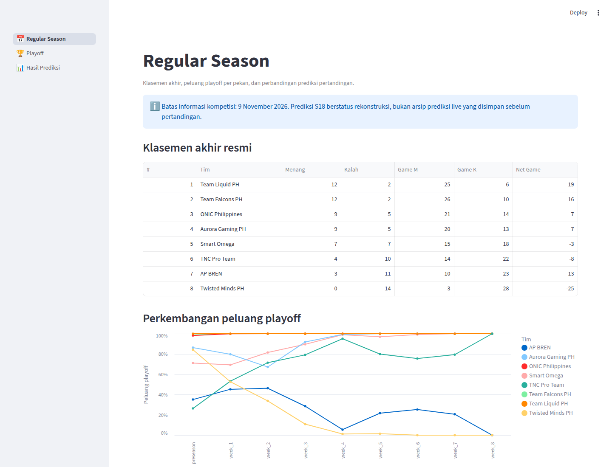
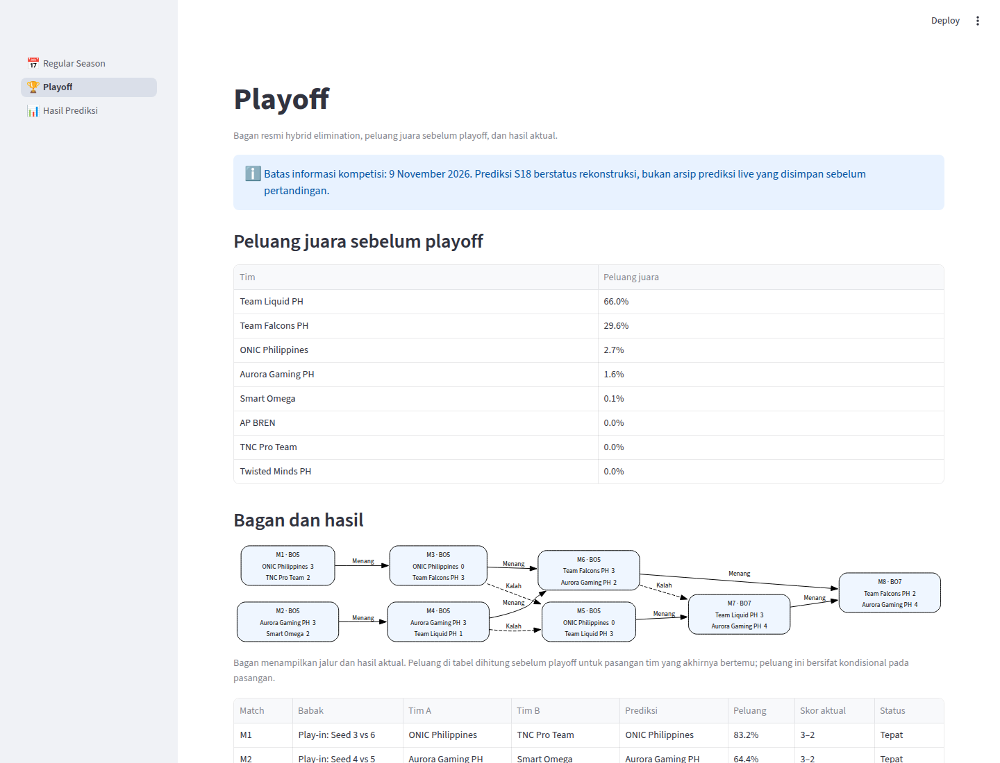
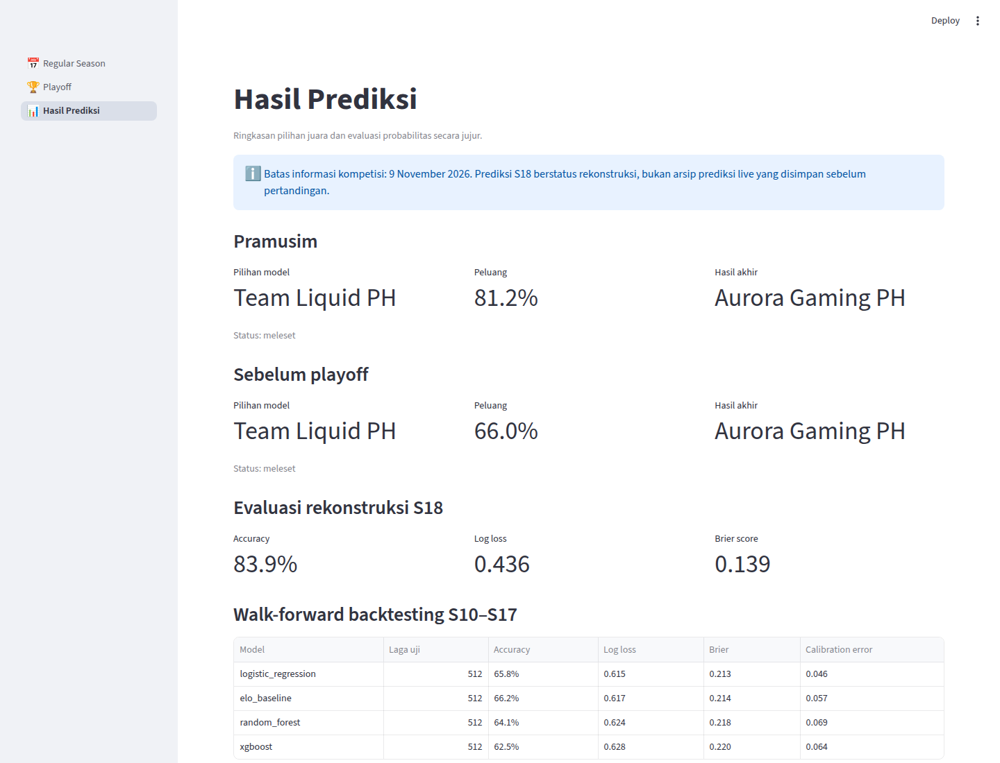

# Prediksi Juara MPL Philippines Season 18

Proyek ini memperkirakan probabilitas kemenangan pertandingan, peluang lolos playoff,
dan peluang juara MPL Philippines Season 18. Dashboard Streamlit membandingkan hasil
rekonstruksi prediksi dengan hasil aktual secara ringkas dan berbahasa Indonesia.

Data dibatasi sampai **9 November 2026**. Karena S18 sudah selesai ketika proyek dibuat,
prediksi S18 diberi label **`reconstructed`**. Prediksi tersebut membangun ulang keadaan
sebelum setiap laga, tetapi bukan arsip prediksi yang benar-benar disimpan pada tanggal
pertandingan.

## Tampilan aplikasi

Screenshot berikut diambil langsung dari aplikasi lokal yang menggunakan artefak prediksi
di repository ini.

| Regular Season | Playoff | Hasil Prediksi |
| :---: | :---: | :---: |
| [](assets/screenshots/regular-season.png) | [](assets/screenshots/playoff.png) | [](assets/screenshots/hasil-prediksi.png) |

## Fitur

- **Regular Season:** klasemen resmi, perkembangan peluang playoff, jadwal, probabilitas,
  skor aktual, dan status tepat/meleset; minggu terbaru ditampilkan lebih dahulu.
- **Playoff:** bagan hybrid elimination resmi, peluang juara sebelum playoff, prediksi
  setiap seri, dan hasil aktual.
- **Hasil Prediksi:** pilihan juara pramusim dan sebelum playoff, hasil akhir, evaluasi S18,
  serta perbandingan Elo, Logistic Regression, Random Forest, dan XGBoost.
- Pipeline memisahkan `data/raw`, `data/clean`, `data/features`, dan `data/predictions`.
- Semua fitur pertandingan dihitung dari informasi sebelum waktu laga. Audit leakage saat
  ini menghasilkan nol pelanggaran.
- Training dan simulasi dijalankan melalui perintah pembaruan, bukan saat dashboard dibuka.

## Data dan format resmi

Sumber utama adalah [rulebook resmi MPL PH S18](https://ph-mpl.com/rules),
[jadwal dan hasil resmi](https://ph-mpl.com/schedule),
[klasemen resmi](https://ph-mpl.com/data), [daftar tim resmi](https://ph-mpl.com/teams),
halaman roster resmi masing-masing tim, serta
[rilis juara dari MOONTON Games](https://en.moonton.com/news/391.html). Seluruh sumber
dicatat di `data/raw/source_manifest.csv`; pemeriksaan sumber awal dicatat di
`data/raw/historical_source_manifest.csv`. Koleksi utama diambil 9 November 2026;
pemeriksaan ulang sumber historis pada 10 November dicatat dengan tanggal sebenarnya.
Pengambilan detail game berikutnya pada 10 November 2026 dicatat terpisah di
`data/raw/game_detail_source_manifest.csv`; batas informasi kompetisi tetap 9 November.

Format yang diterapkan:

Sistem franchise PH dimulai pada **Season 8**, sesuai
[berita liga](https://ph-mpl.com/news/preview-teams-competing-in-the-mpl-philippines-season-8-playoffs).
Peserta sebelum S8 tidak dipaksa sama;
sesudah S8 akuisisi, pergantian organisasi, dan kemitraan tetap dapat mengubah tim.
Kunci peserta dipisahkan per musim. Rating/riwayat direset antarmusim sebelum S8 dan
pada batas S8; kode berbeda tidak otomatis digabung setelah akuisisi. Carryover kode
yang sama setelah S8 adalah asumsi model, bukan bukti roster atau pemilik tidak berubah.
[Kebijakan identitas](docs/LEAGUE_IDENTITY.md) menjelaskan sumber dan keterbatasannya.

Format berikut khusus **S18**, tidak diterapkan mundur ke musim sebelumnya:

- delapan tim franchise, double round-robin, BO3, 14 pertandingan per tim;
- satu poin untuk kemenangan seri dan nol untuk kekalahan;
- tiebreaker: net game wins, head-to-head match wins, head-to-head net game wins, lalu
  BO1 resmi bila masih diperlukan;
- enam tim ke playoff; seed 3–6 masuk play-in, seed 1–2 mendapat bye;
- seluruh seri playoff BO5, kecuali lower bracket final dan grand final yang BO7.

Katalog mencakup **Season 1–18**, dengan status yang berbeda per musim:

- **S1–S5:** 22 hasil parsial dari berita resmi lama, laporan pertandingan, dan sumber
  pembanding. Jam mulai belum lengkap; hasil BO2 seri S1 dipertahankan. Belum masuk model.
  Delapan hasil tambahan S5 hanya diketahui dalam rentang pekan 6–8 Maret 2020;
  tanggal/jam tiap laga dan BO tidak ditebak. Bukti ekstraksi melalui web reader dicatat
  terpisah dari kegagalan HTTP langsung sumber tersebut, bukan diklaim unduhan HTML berhasil.
- **S6–S18:** 852 laga canonical, termasuk 788 laga sebelum S18 dan 64 laga S18.
  S8 dipulihkan dari halaman jadwal resmi. Tiga skor S6 yang rusak dikoreksi memakai
  dua laporan pertandingan dan berita resmi liga; skor asli serta sumber disimpan.
- Roster S18 memuat 49 pemain dan 17 pelatih/staf. Ada tujuh observasi pemain historis,
  tetapi tanggal efektifnya belum cukup lengkap untuk fitur roster.
- Tujuh tabel mengikuti nama kolom dataset referensi Indonesia. Statistik 49 pemain S18
  tersedia sebagai observasi pascamusim; kolom yang tidak tersedia tetap null dan statistik
  tersebut tidak digunakan untuk fitur S18. [Kamus variabel](docs/DATA_DICTIONARY.md)
  menjelaskan pemetaan dan tipe data.
- Detail scoreboard resmi: 309 game (172 S18 dan 137 S8), 3.090 observasi pemain serta
  hero yang dimainkan. Seluruh 64 seri S18 lolos audit jumlah game dan lima pemain per tim;
  sembilan seri S8 ditolak karena data detail tidak cocok/tidak lengkap. Ini bukan transkrip
  draft: ban, urutan pick, winner per game, dan durasi belum terverifikasi dan tetap null.
  Observasi pascamusim ini tidak dipakai sebagai fitur S18.
  Audit silang 3.090 penghitung ringkasan/scoreboard menemukan 22 selisih pada 20 game S18
  (empat gold dan 18 hero damage); K/D/A cocok. Kedua nilai sumber dipertahankan dengan
  penanda review karena definisi atau waktu observasinya belum dipastikan, bukan diperbaiki otomatis.
- Statistik historis S5–S17: 773 observasi pemain dari halaman arsip resmi. Parser menangani
  format total/rata-rata dan header bertingkat S11–S13. Cakupan tahap serta penetapan tim
  belum terverifikasi; observasi ini bukan roster efektif dan tidak dipakai untuk training.
  Tiga nilai teamfight S12 yang melebihi 100% dikosongkan dengan teks sumber tetap disimpan.
- Nama ECHO pada pertandingan S13 dibedakan menurut tanggal pengumuman akuisisi:
  ECHO sebelum 21 Mei 2024 dan Team Liquid ECHO PH setelahnya. Registry nama tidak
  otomatis menggabungkan rating atau badan hukum tim.
  Registry juga membedakan AP.Bren/Falcons APBren dan ONIC Philippines/Fnatic ONIC PH.
  Pengumuman [Fnatic](https://fnatic.com/news/fnatic-partners-with-onic-esports) menyebut
  nama kompetisi mulai digunakan pada 22 Mei, bukan otomatis pada hari pengumuman 21 Mei.

Audit silang total match/game W/L regular season cocok pada S7, S11–S15, S17, dan S18.
Musim lainnya masih perlu pemeriksaan: sumber S1–S4 mengembalikan HTTP 500, S5 belum
mempunyai hasil regular season canonical, dan S6/S8/S9/S16 masih menunjukkan konflik.
Seluruh penghitung S10 cocok dengan semua 64 laga yang dikumpulkan, termasuk playoff;
angka arsipnya bukan klasemen regular season. Pencocokan scope ini tidak mengubah skor
dan bukan bukti bahwa seluruh laga/playoff lengkap.
Laporan rinci: `reports/season_reconciliation.json`; konflik tidak mengubah skor otomatis.

Cakupan dan kekurangan setiap musim tercatat di `reports/season_coverage.csv`.
Data per musim memakai `data/mpl-season1` sampai `data/mpl-season17` dan `data/season18`,
mengikuti proyek referensi MPL Indonesia. Data olahan juga tersedia di
`data/interim/normalized` dan `data/processed/{canonical,features,predictions}`;
model berada di `artifacts/final_match_model.joblib`.
[Pemetaan struktur](docs/STRUCTURE.md) dan [catatan sumber](docs/DATA_SOURCES.md) menjelaskan
penyesuaian khusus PH. Tabel opsional yang belum tersedia hanya berisi header, tanpa data buatan.

## Hasil model

Walk-forward backtesting memakai S10–S17 sebagai jendela uji dan hanya melatih pada musim
yang lebih lama. Setelah pemisahan era franchise dan reset state pra-S8 diterapkan,
Logistic Regression menjadi model produksi dengan log loss 0,615, dibanding Elo 0,617,
Random Forest 0,624, dan XGBoost 0,628. Pemilihan ini dilakukan sebelum evaluasi S18 dan hasil S18 tidak dipakai untuk
training atau pemilihan model.

Pada rekonstruksi regular season S18, model memperoleh accuracy 83,9%, log loss 0,436, dan
Brier score 0,139. Rekonstruksi pramusim memilih Team Liquid PH dengan peluang juara 81,2%,
sedangkan juara aktual adalah Aurora Gaming PH. Hasil meleset ini tetap ditampilkan apa
adanya.

## Menjalankan dashboard

Gunakan Python 3.11 atau lebih baru. Cukup jalankan:

```bash
make run
```

Pada pemakaian pertama, perintah tersebut otomatis membuat `.venv` dan memasang dependensi
dengan `pip` (bukan `uv`), lalu membuka dashboard di `http://127.0.0.1:8501`. Pemakaian
berikutnya langsung menjalankan aplikasi. Dashboard hanya membaca artefak CSV yang sudah
tersedia, sehingga dapat dijalankan tanpa training ulang.
Linux x86_64 menggunakan varian resmi `xgboost-cpu` versi yang sama untuk training CPU;
platform lain memakai paket XGBoost standar. GPU tidak diperlukan oleh proyek ini.

Target lain yang tersedia dapat dilihat dengan `make help`. Port dapat diganti, misalnya
`make run PORT=8502`.

## Memperbarui data dan prediksi

Pembaruan penuh dari sumber resmi:

```bash
make update
```

Membangun ulang dari data mentah lokal tanpa mengakses web:

```bash
make rebuild
```

Mengambil detail game resmi tanpa training ulang: `make collect-details`.
Data cache diperiksa dengan SHA-256; gunakan
`make collect-details DETAIL_ARGS="--seasons 18 --cache-only"` untuk ekspor offline.
Statistik arsip dan audit silang klasemen tersedia melalui `make collect-season-data`,
atau `make collect-season-data EVIDENCE_ARGS=--cache-only` untuk memakai bukti lokal.
Gunakan `make audit-game-data` untuk membandingkan ringkasan game dengan scoreboard lokal
tanpa jaringan atau training. Hasil dan kedua nilai yang berbeda ada pada
`reports/game_summary_audit.json` dan `reports/game_summary_checks.csv`.

Jumlah simulasi dapat diubah melalui `simulation.iterations` di `config/model.json`.
Setiap pembaruan otomatis mengarsipkan keadaan sebelum dan sesudah pipeline di
`data/predictions/history`. Snapshot memakai waktu simpan sebenarnya, checksum, dan pembuatan
eksklusif agar riwayat tidak tertimpa. Jalankan `make verify-history` untuk memeriksa integritas.
Label S18 tetap rekonstruksi. [Petunjuk prediksi live](docs/LIVE_PREDICTIONS.md) menyediakan
perintah untuk laga mendatang dan evaluasi terpisah; saat ini belum ada prediksi live asli.

BO1 tiebreak disimulasikan memakai probabilitas model. Untuk tiebreak tiga tim atau lebih,
urutan awal masih menggunakan undian karena total durasi kemenangan tidak tersedia.
Snapshot mingguan memakai siang hari berikutnya sebagai asumsi rekonstruksi; arsip tidak
menyediakan waktu publikasi hasil yang sebenarnya. Keterbatasan ini juga tampil di dashboard.

## Pengujian

```bash
make check
```

Uji tiga halaman tanpa jaringan/training: `make smoke`. Untuk menguji salinan berisi
hanya berkas yang dapat ikut Git, dengan virtual environment baru:

```bash
make verify-release RELEASE_ARGS=--fresh-env
```

Salinan dan log berada di `.cache/release_checks` dalam proyek ini; ringkasan di
`reports/release_check.json`. Ini pengujian lokal terisolasi, bukan deployment Cloud.

Untuk mengambil ulang screenshot setelah dashboard lokal berjalan:

```bash
.venv/bin/python scripts/capture_screenshots.py
```

## Streamlit Cloud

Gunakan `streamlit_app.py` sebagai main file. `requirements.txt` hanya berisi dependensi
runtime dan seluruh file prediksi yang dibaca dashboard sudah disertakan. Aplikasi tidak
menjalankan kolektor, training, atau simulasi ketika halaman dibuka.
Pengujian lokal memakai Python 3.12; pengujian salinan/venv baru bukan bukti deployment
ke akun Streamlit Cloud.

Daftar pekerjaan selesai dan tertunda: [PROJECT_STATUS.md](PROJECT_STATUS.md).
Operasional lokal: [docs/OPERATIONS.md](docs/OPERATIONS.md).

